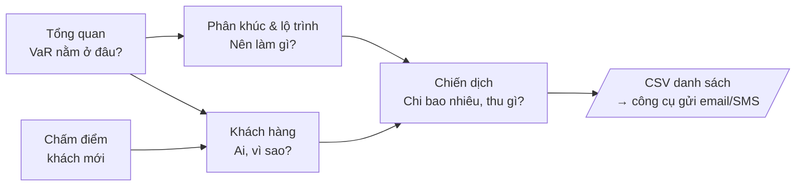

# 02 – FRD: Tài liệu yêu cầu chức năng

> Trạng thái: v2 · Cập nhật: 19/10/2026 · Đi kèm [01-BRD.md](01-BRD.md)
> 7 module, 33 yêu cầu chức năng (26 P0, 7 P1). P0 = bắt buộc cho bản nộp 09/11, P1 = làm nếu còn thời gian.
> Dùng mã FR làm tiêu đề issue/PR, ví dụ `[FR-CAMP-02] xuất danh sách chiến dịch`.

## 1. Luồng làm việc của marketer

Mọi màn hình phục vụ một luồng duy nhất: **thấy vấn đề → chọn tệp khách → lên chiến dịch → xuất danh sách**.

| Màn hình (menu) | Module | Trả lời câu hỏi |
| --- | --- | --- |
| Tổng quan | FR-DASH | Tệp khách đang thế nào, VaR tập trung ở đâu, mô hình tin được đến đâu |
| Khách hàng | FR-CUS | Ai đang rủi ro, vì sao |
| Lộ trình | FR-SEG | Mỗi phân khúc nên làm gì |
| Chiến dịch | FR-CAMP | Nhắm bao nhiêu khách, tốn bao nhiêu, kỳ vọng thu về bao nhiêu |
| Chấm điểm | FR-PRED | Khách mới thuộc phân khúc nào |

## 2. Vai trò

| Vai trò | Quyền |
| --- | --- |
| **Marketer** (Manager, CRM) | Đăng nhập; dùng toàn bộ 5 màn hình. Không chỉnh ngưỡng, không quản lý mô hình. |
| **Nhóm dữ liệu** (superuser Django) | Ngoài web marketing: quản lý tài khoản và sửa nội dung lộ trình qua Django Admin (`/admin/`); train lại và chấm lại bằng script (FR-ML). |

## 3. Quy tắc nghiệp vụ (BR)

Ngưỡng và tham số (τ, P33/P67, g, d, horizon) lưu trong `ml_engine/artifacts/clv_config.json` cùng model active; FE/BE không hard-code.

| Mã | Quy tắc |
| --- | --- |
| BR-01 | `risk_label` = High nếu p_churn ≥ τ, ngược lại Low. τ = 0,186 (tối ưu F2 trên validation, D-14). |
| BR-02 | `clv_tier` = Low nếu clv_potential < P33, Mid nếu P33 ≤ clv_potential < P67, High nếu ≥ P67. P33/P67 tính trên toàn tệp ở lần chấm gần nhất; khách mới dùng ngưỡng đã lưu. |
| BR-03 | `value_at_risk` = p_churn × clv_potential (USD, 2 chữ số). Công thức CLV: [05-clv-methodology.md](05-clv-methodology.md). |
| BR-04 | Phân khúc theo risk_label + clv_tier: High+High = S1, High+Mid = S2, High+Low = S3, Low+High = S4, Low+Mid = S5, Low+Low = S6. Mỗi phân khúc gắn đúng 1 lộ trình. |
| BR-05 | `top_reasons` = 3 feature có SHAP dương lớn nhất, tên tiếng Việt kèm giá trị của khách và trung bình toàn tệp. |
| BR-06 | `channel` gợi ý: S1 → Điện thoại; còn lại → Email nếu Email_Open_Rate ≥ trung vị tập train, ngược lại Push app / SMS. |
| BR-07 | Trường được phép trống khi chấm điểm được impute bằng median tập train và liệt kê trong `imputed_fields`. |
| BR-08 | **Chi phí dự kiến** mỗi khách = k × clv_potential, k = mức chi tối đa của phân khúc (S1 10%, S2 5%, S3 2%, S4 3%, S5 3%, S6 1%; xem [06](06-marketing-journeys.md)). Marketer có thể ghi đè k cho cả chiến dịch. |
| BR-09 | **Chọn khách cho chiến dịch**: lấy khách khớp bộ lọc, sắp VaR giảm dần; nếu có ngân sách B thì lấy lần lượt đến khi tổng chi phí vượt B thì dừng. |
| BR-10 | **Kết quả kỳ vọng** với tỷ lệ thành công giả định s (mặc định 20%, marketer chỉnh 1–100%): VaR giữ lại = s × Σ VaR; ROI = (VaR giữ lại − Σ chi phí) / Σ chi phí; **tỷ lệ hòa vốn** = Σ chi phí / Σ VaR. Mọi con số này hiển thị kèm nhãn "ước tính theo giả định". |

## 4. FR-AUTH — Đăng nhập

| Mã | Chức năng | Mô tả và quy tắc | API / màn hình | Ưu tiên |
| --- | --- | --- | --- | --- |
| FR-AUTH-01 | Đăng nhập | Username + mật khẩu → JWT access (30 phút) + refresh (1 ngày). Sai thông tin hiện một thông báo chung. | `POST /auth/login` · Login | P0 |
| FR-AUTH-02 | Duy trì / kết thúc phiên | FE tự refresh token; đăng xuất xóa token; chưa đăng nhập bị chuyển về Login. | `POST /auth/refresh` · route guard | P0 |

Acceptance criteria

- [ ] Tài khoản `marketer` đăng nhập được ngay sau `seed_db.py`.
- [ ] Gọi API bất kỳ (trừ login) không có token → 401.

## 5. FR-DASH — Tổng quan

| Mã | Chức năng | Mô tả và quy tắc | API | Ưu tiên |
| --- | --- | --- | --- | --- |
| FR-DASH-01 | Thẻ KPI | Tổng khách, % rủi ro cao, tổng CLV kỳ vọng, tổng VaR, ngày chấm điểm. | `GET /dashboard/summary` | P0 |
| FR-DASH-02 | Ma trận 2 × 3 | Mỗi ô: tên phân khúc, số khách, % số khách, tổng VaR, % VaR. Nhấn mạnh S1, S2. | `GET /dashboard/summary` | P0 |
| FR-DASH-03 | Đi tiếp từ ma trận | Mỗi ô có 2 nút: "Xem khách" → Khách hàng lọc sẵn phân khúc; "Lên chiến dịch" → Chiến dịch chọn sẵn phân khúc. | Router | P0 |
| FR-DASH-04 | Biểu đồ | Histogram p_churn (10 bin, vạch τ); cột số khách + VaR theo quốc gia. | `GET /dashboard/summary` | P0 |
| FR-DASH-05 | Độ tin cậy mô hình | Diễn giải bằng lời: "Trong 100 khách thực sự rời đi, mô hình phát hiện 86"; "Trong 100 khách bị gắn rủi ro cao, 72 thực sự rời đi"; ngày train; các giới hạn chính. | `GET /model/info` | P0 |
| FR-DASH-06 | Yếu tố ảnh hưởng toàn tệp | Top 10 feature theo mean \|SHAP\|, tên tiếng Việt, kèm gợi ý hành động cho 3 yếu tố đầu (vd. CSKH, bỏ giỏ). | `GET /model/info` | P1 |
| FR-DASH-07 | Lọc theo quốc gia | Dropdown Country, tính lại toàn bộ thẻ và biểu đồ. | `GET /dashboard/summary?country=` | P1 |

Acceptance criteria

- [ ] Tổng 6 ô ma trận = thẻ tổng số khách; tổng VaR 6 ô = thẻ tổng VaR.
- [ ] Dashboard tải < 2 giây với 50.000 khách (aggregate ở DB).
- [ ] Chưa có dữ liệu → trạng thái trống hướng dẫn chạy `seed_db.py`, không lỗi trang.

## 6. FR-CUS — Khách hàng

| Mã | Chức năng | Mô tả và quy tắc | API | Ưu tiên |
| --- | --- | --- | --- | --- |
| FR-CUS-01 | Danh sách | Phân trang 50 dòng: customer_id, country, p_churn (%), risk_label, clv_potential, clv_tier, VaR, segment. Mặc định VaR giảm dần. | `GET /customers` | P0 |
| FR-CUS-02 | Lọc, tìm, sắp xếp | Lọc AND theo segment (nhiều lựa chọn), risk_label, clv_tier, country, city; tìm theo customer_id; sắp theo p_churn, clv_potential, VaR. Bộ lọc nằm trên URL query. | `GET /customers?segment=&risk=&tier=&country=&city=&q=&sort=` | P0 |
| FR-CUS-03 | Hồ sơ khách | 23 thuộc tính nhóm theo Hành vi / Mua sắm / Tương tác; p_churn, CLV kỳ vọng, CLV tiềm năng, VaR, segment, kênh gợi ý (BR-06), lộ trình đề xuất. | `GET /customers/{id}` | P0 |
| FR-CUS-04 | Giải thích rủi ro | 3 lý do chính (BR-05), ví dụ "Gọi CSKH 12 lần (trung bình 5,7)". | `GET /customers/{id}` | P0 |
| FR-CUS-05 | Xuất CSV | Toàn bộ kết quả bộ lọc (không chỉ trang hiện tại), UTF-8 có BOM, cột như FR-CAMP-03. | `GET /customers/export` | P0 |
| FR-CUS-06 | What-if | Kéo 4 biến marketing tác động được (Customer_Service_Calls, Cart_Abandonment_Rate, Email_Open_Rate, Discount_Usage_Rate), xem p_churn và phân khúc thay đổi. Không lưu. | `POST /predict` | P1 |

Acceptance criteria

- [ ] Lọc S1 + USA trả đúng số dòng so với truy vấn trực tiếp DB.
- [ ] Customer id không tồn tại → 404 và trang "Không tìm thấy khách hàng".
- [ ] CSV mở bằng Excel không lỗi font; số dòng = số kết quả bộ lọc.
- [ ] Bộ lọc không ra kết quả → trạng thái trống có nút "Xóa bộ lọc".

## 7. FR-SEG — Phân khúc và lộ trình

| Mã | Chức năng | Mô tả và quy tắc | API | Ưu tiên |
| --- | --- | --- | --- | --- |
| FR-SEG-01 | Xem 6 lộ trình | Mỗi phân khúc một thẻ: tên, điều kiện (BR-04), số khách, tổng VaR, mục tiêu, các bước theo ngày (kênh, hành động, ưu đãi), KPI, mức chi tối đa, nguồn nghiên cứu. | `GET /journeys` | P0 |
| FR-SEG-02 | Gán tự động | Mỗi khi chấm điểm (batch hoặc khách mới) đều tính segment theo BR-01, 02, 04 và gắn lộ trình. | Service nội bộ | P0 |
| FR-SEG-03 | Nhánh cá nhân hóa | Trong hồ sơ khách, lộ trình hiển thị nhánh theo lý do số 1: gọi CSKH nhiều → xử lý khiếu nại; bỏ giỏ cao → nhắc giỏ; ít mở email → chuyển push app. | `GET /customers/{id}` | P1 |

Nội dung 6 lộ trình: [06-marketing-journeys.md](06-marketing-journeys.md). Sửa nội dung qua Django Admin, không làm màn hình riêng.

Acceptance criteria

- [ ] Sau seed: đủ 6 lộ trình; mọi khách có segment + lộ trình.
- [ ] Ngưỡng τ, P33, P67 hiển thị dạng chỉ đọc trên trang Lộ trình.

## 8. FR-CAMP — Lên chiến dịch

Đây là module trả lời câu hỏi "chi bao nhiêu, thu về gì" của BRD.

| Mã | Chức năng | Mô tả và quy tắc | API | Ưu tiên |
| --- | --- | --- | --- | --- |
| FR-CAMP-01 | Thiết lập chiến dịch | Marketer chọn: phân khúc (mặc định S1 + S2), bộ lọc country/city, ngân sách B (tùy chọn), tỷ lệ chi k (mặc định theo phân khúc, BR-08), tỷ lệ thành công giả định s (mặc định 20%). | Màn hình Chiến dịch | P0 |
| FR-CAMP-02 | Xem trước kết quả | Theo BR-08 → BR-10: số khách được chọn / đủ điều kiện, tổng chi phí, tổng VaR nhắm tới, VaR giữ lại kỳ vọng, ROI, tỷ lệ hòa vốn; tách theo phân khúc. Cập nhật khi đổi tham số. | `POST /campaigns/preview` | P0 |
| FR-CAMP-03 | Xuất danh sách | CSV khách được chọn: customer_id, country, city, segment, tên lộ trình, kênh gợi ý, p_churn, clv_potential, value_at_risk, chi phí dự kiến, lý do số 1. UTF-8 có BOM. | `POST /campaigns/export` | P0 |
| FR-CAMP-04 | Lưu chiến dịch | Đặt tên và lưu tham số + kết quả tóm tắt; xem danh sách chiến dịch đã lưu và xuất lại danh sách. | `POST /campaigns`, `GET /campaigns`, `GET /campaigns/{id}/export` | P1 |
| FR-CAMP-05 | So sánh kịch bản | Đặt 2 bộ tham số cạnh nhau (vd. S1 riêng vs S1 + S2) để so ROI. | FE gọi 2 lần preview | P1 |

Ví dụ minh họa (số giả định): chọn S1, có 2.000 khách, tổng CLV tiềm năng 1,4 triệu USD, tổng VaR 0,9 triệu USD. k = 10% → chi phí 140.000 USD; tỷ lệ hòa vốn = 140.000 / 900.000 ≈ 15,6%; với s = 20% → VaR giữ lại 180.000 USD, ROI ≈ 29%.

Acceptance criteria

- [ ] Kết quả preview khớp tính tay bằng pandas trên cùng tập khách (sai số < 0,01 USD).
- [ ] Có ngân sách B: tổng chi phí ≤ B; khách được chọn là những khách có VaR cao nhất.
- [ ] Số dòng CSV = số khách được chọn trong preview.
- [ ] Màn hình luôn hiển thị nhãn "ước tính theo giả định" cạnh ROI.
- [ ] Bộ lọc không ra khách nào → trạng thái trống, không chia cho 0.

## 9. FR-PRED — Chấm điểm khách mới

| Mã | Chức năng | Mô tả và quy tắc | API | Ưu tiên |
| --- | --- | --- | --- | --- |
| FR-PRED-01 | Chấm 1 khách | Form 23 trường (bảng dưới). Trả p_churn, risk_label, clv_pred, clv_potential, clv_tier, VaR, segment, lộ trình, kênh, 3 lý do; < 500 ms. | `POST /predict` | P0 |
| FR-PRED-02 | Lưu khách mới | Bấm "Lưu vào danh sách" → tạo customer (source = form) + prediction. Không bấm thì không ghi DB. | `POST /predict?save=true` | P0 |
| FR-PRED-03 | Báo lỗi nhập liệu | Angular chặn tại ô; BE trả 400 dạng `{field: message}`. | Serializer + Reactive Forms | P0 |
| FR-PRED-04 | Chấm theo file | Upload CSV ≤ 10.000 dòng, xử lý đồng bộ, trả về CSV kết quả (cột gốc + cột dự đoán); dòng lỗi ghi lý do ở cột `error`. | `POST /predict/batch` | P1 |

### Bảng validate 23 trường input

| Trường | Kiểu | Miền hợp lệ | Bắt buộc |
| --- | --- | --- | --- |
| Age | số nguyên | 13–100 | Tùy chọn |
| Gender | chọn | Male, Female, Other | Bắt buộc |
| Country | chọn | USA, UK, Canada, Germany, Australia, France, India, Japan | Bắt buộc |
| City | chọn | 5 thành phố theo Country (xem [data dictionary](07-data-dictionary.md)) | Bắt buộc |
| Signup_Quarter | chọn | Q1–Q4 | Bắt buộc |
| Membership_Years | số thực | 0–10 | Bắt buộc |
| Login_Frequency | số nguyên | 0–50 | Bắt buộc |
| Session_Duration_Avg (phút) | số thực | 0–120 | Tùy chọn |
| Pages_Per_Session | số thực | 0–30 | Tùy chọn |
| Cart_Abandonment_Rate (%) | số thực | 0–100 | Bắt buộc |
| Wishlist_Items | số nguyên | 0–50 | Tùy chọn |
| Total_Purchases | số thực | 0–150 | Bắt buộc |
| Average_Order_Value (USD) | số thực | > 0 và ≤ 10.000 | Bắt buộc |
| Days_Since_Last_Purchase | số nguyên | 0–365 | Tùy chọn |
| Discount_Usage_Rate (%) | số thực | 0–100 | Tùy chọn |
| Returns_Rate (%) | số thực | 0–100 | Tùy chọn |
| Email_Open_Rate (%) | số thực | 0–100 | Tùy chọn |
| Customer_Service_Calls | số nguyên | 0–30 | Tùy chọn |
| Product_Reviews_Written | số nguyên | 0–30 | Tùy chọn |
| Social_Media_Engagement_Score | số thực | 0–100 | Tùy chọn |
| Mobile_App_Usage | số thực | 0–100 | Tùy chọn |
| Payment_Method_Diversity | số nguyên | 1–5 | Tùy chọn |
| Credit_Balance (USD) | số thực | 0–10.000 | Tùy chọn |

Acceptance criteria

- [ ] Cùng một input, `/predict` và batch score cho cùng p_churn (sai số < 0,001).
- [ ] Age = 200 bị chặn ở FE; gọi thẳng API → 400 kèm lỗi trường Age.
- [ ] Bỏ trống mọi trường tùy chọn vẫn chấm được, kết quả ghi "14 trường được ước lượng".

## 10. FR-ML — Chức năng hệ thống (`ml_engine`, chạy bằng script)

Không có giao diện web. Nhóm dữ liệu chạy khi cần train lại hoặc nạp dữ liệu mới.

| Mã | Chức năng | Mô tả và quy tắc | File | Ưu tiên |
| --- | --- | --- | --- | --- |
| FR-ML-01 | Clean + features | 6 nhóm lỗi trong [data dictionary](07-data-dictionary.md), 5 feature mới + encoding; một sklearn Pipeline dùng chung cho train và `/predict`. | `clean.py`, `features.py` | P0 |
| FR-ML-02 | Train + đánh giá | ≥ 3 thuật toán, Optuna, 5-fold CV, seed 42; hiệu chỉnh isotonic, chọn τ theo F2; báo cáo vào `reports/`. | `train.py`, `evaluate.py` | P0 (đã xong) |
| FR-ML-03 | Explain | SHAP: global importance + top 3 lý do mỗi khách. | `explain.py` | P0 |
| FR-ML-04 | CLV + segment | CLV kỳ vọng / tiềm năng, VaR, P33/P67, segment, kênh (BR-01 → BR-06). | `clv.py`, `segment.py` | P0 |
| FR-ML-05 | Lưu artifact | `churn_vX.joblib` + `clv_config.json` (τ, P33, P67, g, d, horizon, median Email_Open_Rate, metrics, ngày train, global importance). | `train.py` | P0 |
| FR-ML-06 | Seed + batch score | `python scripts/seed_db.py`: nạp CSV, 6 lộ trình, tài khoản demo, chấm 50.000 khách (`bulk_create` lô 1.000) < 2 phút. Chạy lại không tạo trùng. | `scripts/seed_db.py` | P0 |

Acceptance criteria

- [ ] `train.py` chạy 2 lần cùng dữ liệu cho cùng metrics.
- [ ] `pytest ml_engine/tests` pass, có test cho từng quy tắc làm sạch và cho `clv.py`.
- [ ] Máy mới clone repo, chạy `seed_db.py` một lần là dashboard có đủ 50.000 khách.

## 11. Yêu cầu phi chức năng

| Mã | Yêu cầu |
| --- | --- |
| NFR-01 | `/predict` p95 < 500 ms (model nạp một lần khi Django khởi động); Dashboard < 2 giây; preview chiến dịch < 2 giây với 50.000 khách. |
| NFR-02 | Toàn bộ giao diện và tên feature hiển thị bằng tiếng Việt; tiền USD 2 chữ số, xác suất dạng %. |
| NFR-03 | Mọi số mô phỏng (ROI, VaR giữ lại) gắn nhãn "ước tính theo giả định". |
| NFR-04 | Clone repo và chạy theo README trên máy Windows mới trong < 15 phút. |

## 12. Truy vết BRQ → FR

| BRQ ([01-BRD](01-BRD.md)) | FR |
| --- | --- |
| BRQ-01 Tổng quan sức khỏe tệp khách | FR-DASH-01, 02, 04, 07 |
| BRQ-02 Xếp hạng, lọc, giải thích | FR-CUS-01 → 04, 06; FR-ML-03 |
| BRQ-03 Lộ trình theo phân khúc | FR-SEG-01 → 03; FR-ML-04 |
| BRQ-04 Mô phỏng chiến dịch | FR-CAMP-01, 02, 04, 05 |
| BRQ-05 Xuất danh sách | FR-CAMP-03; FR-CUS-05 |
| BRQ-06 Chấm điểm khách mới | FR-PRED-01 → 04 |
| BRQ-07 Độ tin cậy mô hình | FR-DASH-05, 06; FR-ML-02 |
