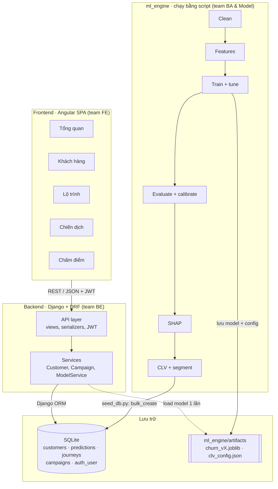
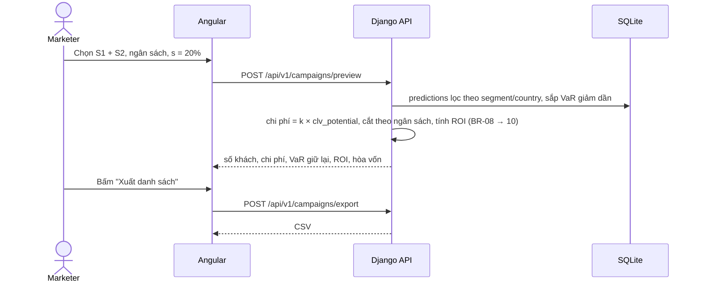
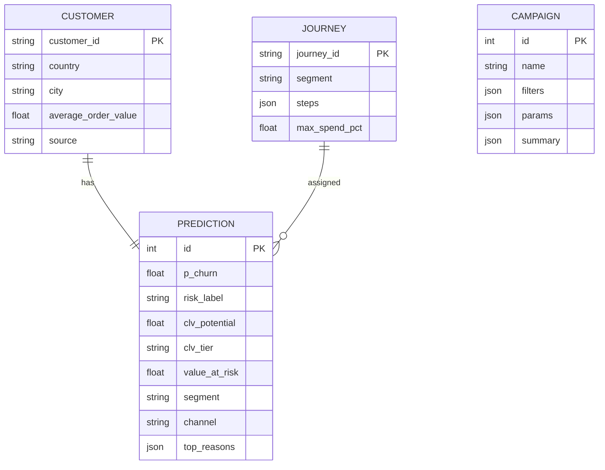

# 03 – Kiến trúc hệ thống và data model

## 1. Tổng quan

Điểm số được chấm sẵn vào SQLite bằng script; Angular chỉ đọc qua Django API. Hai ngoại lệ tính toán lúc gọi: `/predict` (chấm khách mới bằng `ModelService`, model nạp sẵn khi Django khởi động) và `/campaigns/preview` (cộng dồn chi phí / VaR trên các dòng `predictions` đã có).

Train lại mô hình **không đi qua web**: nhóm dữ liệu chạy `train.py` rồi `seed_db.py --rescore` (D-17).

## 2. Hai luồng chính

**Offline (nhóm dữ liệu).** `python -m ml_engine.src.train` → lưu `churn_vX.joblib` + `clv_config.json` → `python scripts/seed_db.py` nạp khách, 6 lộ trình, tài khoản demo và chấm 50.000 khách vào `predictions`.

**Online (marketer).** Dashboard, Khách hàng, Lộ trình, Chiến dịch đọc từ DB. Chấm điểm: form → `POST /predict` → serializer validate → `ModelService` (clean → features → p_churn → CLV → SHAP → segment) → JSON; `save=true` thì lưu `customers` + `predictions`.

## 3. Pipeline ML (`ml_engine/src/`)

| Bước | File | Việc làm |
| --- | --- | --- |
| 1. Clean | `clean.py` | Làm sạch theo [07-data-dictionary.md](07-data-dictionary.md); dạng sklearn transformer |
| 2. Features | `features.py` | Feature mới + one-hot / target-encode |
| 3. Train + tune | `train.py` | Split 70/15/15 stratify, seed 42; LR, RF, LightGBM; Optuna; chọn theo PR-AUC 5-fold |
| 4. Evaluate | `evaluate.py` | ROC-AUC, PR-AUC, Recall, F1; calibration isotonic; τ theo F2 → `reports/churn_tune.json` |
| 5. Explain | `explain.py` | SHAP → top 3 lý do + global importance |
| 6. CLV + segment | `clv.py`, `segment.py` | CLV kỳ vọng/tiềm năng, VaR, P33/P67, segment, kênh |
| 7. Seed + score | `scripts/seed_db.py` | Ghi `customers`, `predictions`, `journeys`, tài khoản demo |

**Leakage:** không dùng `Lifetime_Value` làm feature cho model churn.

## 4. Data model (SQLite qua Django ORM)

| Bảng (model) | Khóa | Cột chính | Index |
| --- | --- | --- | --- |
| `customers` (Customer) | customer_id (PK) | 23 thuộc tính đã làm sạch, source (seed/form), created_at | country |
| `predictions` (Prediction) | id; FK customer (unique) | p_churn, risk_label, clv_pred, clv_potential, clv_tier, value_at_risk, segment, FK journey, channel, top_reasons (JSON), model_version, scored_at | segment, value_at_risk |
| `journeys` (Journey) | journey_id | segment (unique), name, goal, steps (JSON: day, channel, action, offer), kpi, max_spend_pct | — |
| `campaigns` (Campaign) — P1 | id | name, filters (JSON), params (JSON: budget, k, s), summary (JSON), created_by, created_at | — |
| `auth_user` | id | User có sẵn của Django | username |

Tham số mô hình (τ, P33, P67, g, d, metrics, global importance) **không lưu DB**: `ModelService` đọc từ `clv_config.json` khi khởi động.

Ghi chú:

- `db.sqlite3` không commit; `scripts/seed_db.py` dựng lại từ CSV.
- Bật WAL mode để đọc được trong lúc seed đang ghi.
- Cần nhiều người ghi đồng thời → đổi sang PostgreSQL bằng `DATABASES`, không sửa model.

## 5. Xử lý lỗi và hiệu năng

- **Load model 1 lần** khi Django khởi động (singleton `ModelService`) → `/predict` < 500 ms.
- **Validation 2 lớp:** Angular Reactive Forms + DRF serializer, trả 400 `{field: message}`.
- **Preview chiến dịch** tính bằng ORM + window/cumsum trên tối đa 50.000 dòng → < 2 giây; không cần cache.
- **Batch score** dùng `bulk_create(update_conflicts=True)` lô 1.000 dòng trong một transaction.

## 6. Trade-offs đã chọn

| Quyết định | Chọn | Bỏ qua | Lý do |
| --- | --- | --- | --- |
| Phục vụ ML | `ml_engine` import trong Django | Microservice FastAPI | 1 process, team BE 2 người quản lý được |
| Scoring | Batch lưu sẵn + realtime cho khách mới | Realtime mọi request | Dashboard đọc nhanh từ DB |
| Retrain | Script CLI | Job runner + màn hình Models | Không phải nhu cầu của marketing (D-17) |
| Lưu tham số mô hình | `clv_config.json` cạnh model | Bảng `model_registry` | Chỉ có 1 version active; không cần UI quản lý |
| CLV | Chiết khấu 3 năm + p_churn | BG/NBD + Gamma-Gamma | BG/NBD khớp kém với nhãn churn (AUC 0,61) |
| Phân khúc | Luật 2 × 3 | K-Means | Dễ giải thích, gắn thẳng hành động |
| Database | SQLite | PostgreSQL | Chạy local, không cần cài server |
